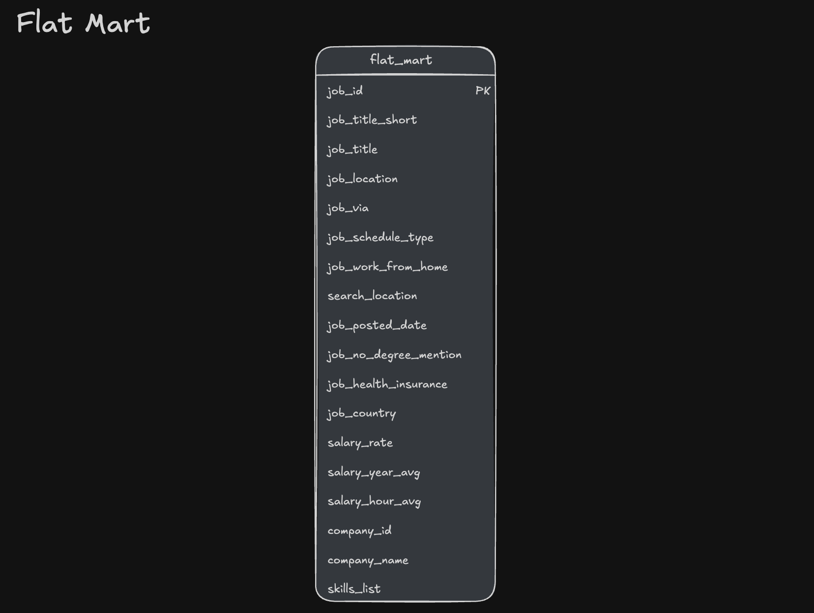
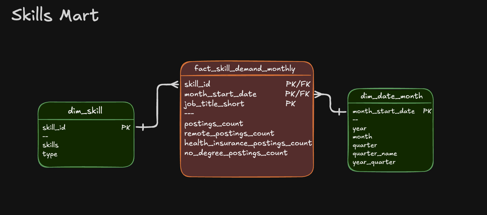
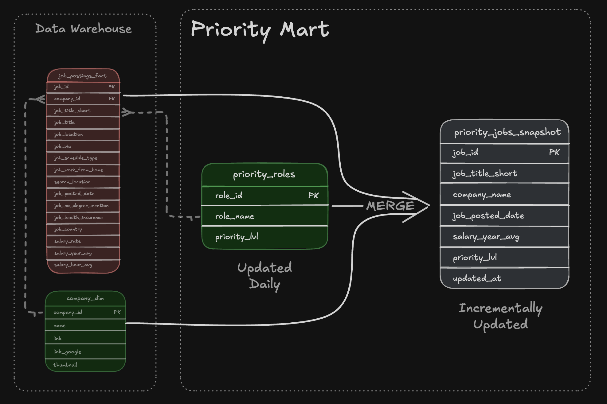
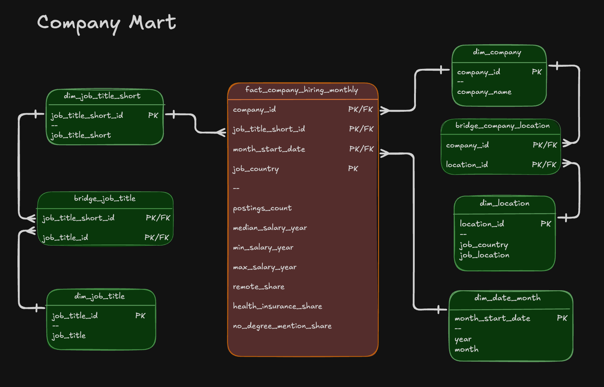

# Data Warehouse & Mart Build: Production ETL Pipeline 

An end-to-end data engineering pipeline that transforms raw CSV files from Google Cloud Storage into a normalised star schema data warehouse and builds analytical data marts. The image below represents a schema of the data warehouse.

## Executive Summary

**Project scope**: Build a complete ETL pipeline from raw CSVs to star schema warehouse to analytical marts

**Data modeling**: Designed a star schema data warehouse with fact, dimension and bridge tables for many-to-many relationships

**ETL development**: Implemented extract, transform and load processes with idempotent operations and data validation checks

**Mart architecture**: Created data marts for specialized analytical functions with incremental update patterns

## Problem & Context

Raw data usually arrives in the form of JSON, XML, CSV or other extentions. For consistent, reliable analysis a single source of subject oriented, non-volatile, integrated and time-variant data, otherwise known as a data warehouse, is needed. In addition, specialized data marts can serve to optimize analysis by pre-aggregating and filtering data for specific business use cases, reducing query complexity for common analytical patterns.  
This project handles job posting data in the form of CSV files. The data was extracted from Google Cloud Storage, normalized and stored inside of a star schema data warehouse (separating facts from dimensions). The data was additionally transformed and stored inside several data marts for more efficient analysis of specific use cases (flat queries, skill demand analysis, priority role tracking).

## Tech Stack

**Database:** DuckDB (file-based OLAP database with GCS integration via httpfs) 
**Language:** SQL (DDL for schema design, DML for data loading and transformation) 
**Data Model:** Star schema (fact + dimension + bridge tables) 
**Development:** VS Code for SQL editing + Terminal for DuckDB CLI execution 
**Automation:** Master SQL script for pipeline orchestration 
**Version Control:** Git/GitHub for versioned pipeline scripts 
**Storage:** Google Cloud Storage for source CSV files 

## Pipeline Architecture

### Data Warehouse

The image below represents the normalized star schema data warehouse with dimension tables and a fact table.

- **SQL Files:**\
&nbsp;&nbsp;- [`01_Create_Tables_dw.sql`](./01_Create_Tables_dw.sql) – Defines star schema with 4 core tables 
&nbsp;&nbsp;- [`02_Load_Schema_dw.sql`](./02_Load_Schema_dw.sql) – Extracts CSVs from GCS and loads into warehouse tables 
- **Purpose:** Star schema serving as single source of truth for analytical queries 
- **Grain:** One row per job posting in the fact table (`job_postings_fact`)

### Flat Mart

Denormalized table with all dimensions for business intelligence, dashboards and reports.

- **SQL Files:**\
&nbsp;&nbsp;- [`03_Create_Flat_Mart.sql`](./03_Create_Flat_Mart.sql) – Builds a denormalized table with all dimensions joined 
- **Purpose:** Flat table used for quick ad-hoc queries 
- **Grain:** One row per job posting with all the dimensions tables joined

### Skills Mart

Time-series skill demand analysis with additive measures.

- **SQL Files:**\
&nbsp;&nbsp;- [`04_Create_Skills_Mart.sql`](./04_Create_Skills_Mart.sql) – Builds a mart that tracks in demand skills over time 
- **Purpose:** Used for efficient analysis of skill demand over time with additive measures 
- **Grain:** `skill_id + month_start_date + job_title_short`

### Priority Mart

Determining and updating level of priority for roles.

- **SQL Files:**\
&nbsp;&nbsp;- [`05_Create_Priority_Mart.sql`](./05_Create_Priority_Mart.sql) – Creates the priority mart tables 
&nbsp;&nbsp;- [`06_Update_Priority_Mart.sql`](./06_Update_Priority_Mart.sql) – Incrementally updates `priority_jobs_snapshot` for priority mart 
- **Purpose:** Track priority roles with incremental updates 
- **Grain:** One row per job posting with priority level mentioned

### Company Mart

Company hiring trends by role, location and month.

- **SQL Files:**\
&nbsp;&nbsp;- [`07_Create_Company_Mart.sql`](./07_Create_Company_Mart.sql) – Creates the company mart 
- **Purpose:** Used to determine analyse company hiring trends by role, month and location 
- **Grain:** `company_id + job_title_short_id + location_id + month_start_date`